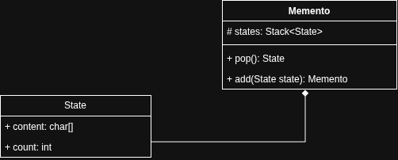

# itk.academy |  практическое задание - StringBuilder

## Задание

Изучите внутреннюю реализацию класса StringBuilder и напишите свою с добавлением дополнительного метода - `undo()`.

Прежде чем приступать - прочитайте про **паттерн snapshot** и примените его в своей реализации.

***примечание**: полностью переписывать все методы которые есть в `StringBuilder` не нужно, в задании важно именно понимание сути паттерна. В случае, если задание остаётся непонятным, задайте вопрос ментору*.

## Реализация паттерна Snapshot



Класс `Memento` хранит в себе состяние которые были добавлены с помощью метода `add(state)` и возвращает состаяние по принципу FIFO с помощью метода `pop()`.

Класс `State` хранит в себе информацию о количестве capacity и содержашие контента.

## Класс `StringBuilder`

Работает практически как `java.lang.StringBuilder`: хранит в себе информацию емкость и массив символов.
Перед конкатенацией контента сохраняется прошлое состояние. И, если необходимо отменить конкатенацию,
то можно воспользоваться методом `undo()`.

```java
import org.rkov.string.undo.StringBuilder;

public class App {
    public static void main(String[] args) {
        var stringBuilder = new StringBuilder();

        stringBuilder.append("Hello");
        stringBuilder.append(" World");

        // Hello World
        System.out.println(stringBuilder.toString());

        stringBuilder.undo();

        // Hello
        System.out.println(stringBuilder.toString());
    }
} 

```
